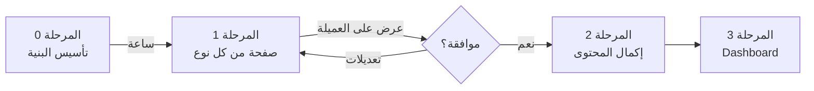

# 🎯 خطة تحويل English Spark — من منصة SaaS إلى بوابة إنتاج معرفي

## الوضع الحالي

### ما تم حفظه
النسخة الكاملة لمنصة SaaS (الاختبارات، الجلسات، الاشتراكات، الشهادات) محفوظة في:
```
git tag: v1.0-saas-platform
```
يمكنك استعادتها في أي وقت لمشاريع أخرى بـ `git checkout v1.0-saas-platform`.

### ما تريده العميلة فعلاً
**موقع تعليمي تفاعلي مفتوح** (إنتاج معرفي) — أي شخص يدخل بضغطة زر بدون حساب أو كود. يتصفح، يتعلم، يلعب مسابقة المليون، ويترك تعليقاً.

---

## الاستضافة والقيود المالية

| الخدمة | الحالية | الحدود المجانية | الاستراتيجية |
|--------|---------|----------------|-------------|
| **Vercel** (Frontend) | ✅ مجاني | 100GB bandwidth/شهر، builds غير محدودة | **الركيزة الأساسية** — كل المحتوى التعليمي يُقدم كصفحات ثابتة من Vercel مباشرة. سريع جداً، بدون Cold Start |
| **Render** (Backend) | ✅ مجاني | ينام بعد 15 دقيقة، Cold Start ~30 ثانية | **نقلله الاعتماد** — نستخدمه فقط لحفظ التعليقات (Guestbook) ولوحة التحكم لاحقاً |
| **Supabase** (DB) | ✅ مجاني | 500MB storage، 50k rows | **كافي تماماً** — التعليقات لن تتجاوز آلاف الصفوف |

> [!IMPORTANT]
> **القرار المعماري الحاسم:** كل المحتوى التعليمي (القواعد، الفيديوهات، الأسئلة) يُخزن كملفات JSON/TypeScript ثابتة داخل الفرونت إند ويُقدم مباشرة من Vercel.
> هذا يعني:
> - ⚡ لا انتظار للباك إند (صفر Cold Start)
> - 🌍 سرعة فائقة لأي زائر في العالم (Vercel CDN)
> - 💰 لا تكلفة إضافية
> - 🔧 المعلمة تعدّل المحتوى لاحقاً عبر Dashboard يكتب ملفات JSON جديدة

---

## خريطة الموقع النهائية

```
/                        → البوابة الرئيسية (بطاقات الأقسام الستة)
/grammar                 → فهرس القواعد (بطاقات الأزمنة)
/grammar/:topicSlug      → صفحة قاعدة واحدة (صورة + فيديو + اختبار تفاعلي)
/reading                 → فهرس قطع القراءة
/reading/:passageSlug    → قطعة قراءة + أسئلة تفاعلية + زر إظهار الحل
/listening               → فهرس أنشطة الاستماع
/listening/:activitySlug → مقطع صوتي/فيديو + أسئلة
/speaking                → فهرس أنشطة النطق والمحادثة
/speaking/:activitySlug  → تمرين نطق/محادثة
/challenge               → مسابقة من سيربح المليون (15 سؤال متدرج)
/guestbook               → سجل الزوار والتعليقات
/teachers                → (يبقى كما هو) صفحة تعريفية للمعلمين
/auth/*                  → (يبقى كما هو) تسجيل الدخول للمعلمة
/dashboard/*             → (يبقى كما هو) لوحة تحكم المعلمة
```

---

## المحتوى المتاح الآن (في فولدر assets)

### بطاقات القواعد (11 صورة JPEG)
| # | القاعدة | الملف |
|---|---------|-------|
| 1 | Present Simple (مبسط) | `WhatsApp Image ... 12.41.04 AM (1).jpeg` |
| 2 | Present Simple (تفصيلي) | `WhatsApp Image ... 12.41.03 AM (2).jpeg` |
| 3 | Present Progressive | `WhatsApp Image ... 12.41.02 AM.jpeg` |
| 4 | Present Perfect | `WhatsApp Image ... 12.41.03 AM.jpeg` |
| 5 | Past Simple | `WhatsApp Image ... 12.41.03 AM (4).jpeg` |
| 6 | Past Progressive | `WhatsApp Image ... 12.41.02 AM (1).jpeg` |
| 7 | Past Perfect | `WhatsApp Image ... 12.41.03 AM (1).jpeg` |
| 8 | Simple Future | `WhatsApp Image ... 12.41.03 AM (3).jpeg` |
| 9 | Future Simple | `WhatsApp Image ... 12.41.04 AM.jpeg` |
| 10 | Future Progressive | `WhatsApp Image ... 12.41.02 AM (2).jpeg` |
| 11 | Future Perfect | `WhatsApp Image ... 12.41.02 AM (3).jpeg` |

### فيديوهات شرح كرتونية (9 فيديوهات MP4)
~4-10MB لكل فيديو — قصيرة وتفاعلية

### مصادر خارجية (من رسائل العميلة)
- **اختبارات قواعد:** https://test-english.com/grammar-points/
- **استماع:** https://test-english.com/listening/
- **نطق:** https://engnovate.com/pronunciation-exercises/
- **محادثة AI:** https://engnovate.com/ai-conversations/
- **قراءة:** https://readtheory.org/ + قطع من Liveworksheets

---

## خطة التنفيذ المرحلية

### المرحلة 0: التأسيس (قبل بناء أي صفحة)

**المدة:** ساعة واحدة

1. **إنشاء بنية البيانات الثابتة:**
   ```
   apps/web/src/data/content/
   ├── grammar.ts      ← بيانات كل قاعدة (عنوان، وصف، مسار الصورة، رابط الفيديو، أسئلة)
   ├── reading.ts       ← بيانات قطع القراءة
   ├── listening.ts     ← بيانات أنشطة الاستماع
   ├── speaking.ts      ← بيانات أنشطة النطق
   └── challenge.ts     ← أسئلة مسابقة المليون (15 سؤال)
   ```

2. **نقل الصور إلى public وتسميتها بأسماء واضحة:**
   ```
   apps/web/public/content/grammar/
   ├── present-simple.jpg
   ├── present-progressive.jpg
   ├── past-simple.jpg
   └── ...
   ```

3. **الفيديوهات:** تُرفع على YouTube (غير مدرجة/Unlisted) وتُضمن بـ iframe — لا نضعها في Vercel لأنها كبيرة الحجم (~65MB إجمالي).

---

### المرحلة 1: صفحة عرض واحدة من كل نوع (للعرض على العميلة)

> [!TIP]
> **هذه هي المرحلة التي نبنيها أولاً** — صفحة واحدة فقط من كل قسم لنعرضها على مريم وصاحبتها ونأخذ موافقتهم قبل إكمال الباقي.

#### 1. البوابة الرئيسية الجديدة `/`
- تصميم مبهر باسم "English Spark — إنتاج معرفي"
- 6 بطاقات كبيرة ملونة بأيقونات واضحة:
  - 📝 القواعد (Grammar)
  - 📖 القراءة (Reading)
  - 🎧 الاستماع (Listening)
  - 🗣️ المحادثة (Speaking)
  - 🏆 مسابقة المليون (Challenge)
  - 💬 سجل الزوار (Guestbook)
- شعار English Spark + شعار وزارة التعليم
- الخلفية المتحركة (PublicBackdrop) التي بنيناها سابقاً
- **لا كود دخول، لا تسجيل — فقط اضغط وادخل**

#### 2. صفحة قاعدة واحدة `/grammar/present-simple`
- بطاقة القاعدة (الصورة التي صممتها مريم)
- فيديو الشرح الكرتوني (YouTube embed)
- اختبار تفاعلي سريع (3-4 أسئلة اختيار من متعدد)
- النتيجة تظهر فوراً بعد كل سؤال (✅ أو ❌ مع التوضيح)
- زر "القاعدة التالية" للانتقال

#### 3. صفحة قطعة قراءة واحدة `/reading/sample-passage`
- نص إنجليزي قصير (من القطع التي أرسلتها)
- أسئلة اختيار من متعدد تحت النص
- زر "أظهر الحل" يكشف الإجابات الصحيحة مع التوضيح
- تصحيح فوري لكل سؤال

#### 4. صفحة استماع واحدة `/listening/sample-activity`
- مقطع فيديو/صوت مضمّن
- أسئلة فهم بعد الاستماع
- تصحيح تفاعلي فوري

#### 5. مسابقة المليون `/challenge`
- **نعيد استخدام تصميم Progressive Challenge الموجود** لكن بدون كود دخول!
- الطالب يكتب اسمه فقط ويبدأ فوراً
- 15 سؤال متدرج الصعوبة بتصميم "من سيربح المليون"
- **الأسئلة ثابتة في الفرونت (لا باك إند)** — تصحيح فوري على المتصفح

#### 6. سجل الزوار `/guestbook`
- صندوق بسيط: الاسم + التعليق + زر إرسال
- يظهر آخر 20 تعليق
- **هذه الصفحة الوحيدة التي تحتاج الباك إند (Render)**

---

### المرحلة 2: إكمال المحتوى (بعد موافقة العميلة)

بعد أن تعرض المرحلة 1 على مريم وتوافق على الشكل:
- نكمل باقي صفحات القواعد (11 قاعدة كاملة)
- نضيف قطع القراءة المتبقية
- نضيف أنشطة الاستماع
- نضيف أنشطة النطق والمحادثة
- نضبط الأسئلة التفاعلية لكل قسم

### المرحلة 3: لوحة تحكم المعلمة (Dashboard)

> [!NOTE]
> لوحة التحكم الحالية (Studio) تبقى كما هي — نضيف عليها واجهة بسيطة لتعديل المحتوى التعليمي (إضافة/تعديل/حذف قواعد، قطع قراءة، أسئلة) بحيث المعلمة تقدر تحدّث المحتوى بنفسها بدون مبرمج.

---

## الفيديوهات — حل مشكلة الحجم

الفيديوهات الـ9 في `assets` حجمها الإجمالي ~65MB.

| الحل | المميزات | العيوب |
|------|----------|--------|
| **YouTube Unlisted** ⭐ الأفضل | مجاني تماماً، سريع، CDN عالمي، يشتغل على كل الهواتف | يحتاج حساب YouTube |
| Cloudinary Free | 25GB bandwidth مجاني | محدود |
| Supabase Storage | متكامل مع المشروع | 1GB حد مجاني |

**التوصية:** رفع الفيديوهات على YouTube كـ Unlisted (غير مدرجة) وتضمينها بـ iframe. الطالب يشاهدها بسلاسة والمعلمة تتحكم فيها من حسابها.

---

## ملخص تنفيذي



| المرحلة | ماذا نبني | يعتمد على |
|---------|-----------|-----------|
| **0** | بنية البيانات + نقل الصور | Vercel فقط |
| **1** | 6 صفحات عرض (واحدة من كل نوع) | Vercel + Render (للتعليقات فقط) |
| **2** | باقي المحتوى | Vercel فقط |
| **3** | Dashboard للمعلمة | Vercel + Render + Supabase |

> [!CAUTION]
> **لا نحذف أي كود حالي.** نضيف الصفحات الجديدة بجانب الصفحات الموجودة. لوحة التحكم (Dashboard) والـ Auth وكل البنية التحتية تبقى كما هي — سنحتاجها في المرحلة 3 وما بعدها.
